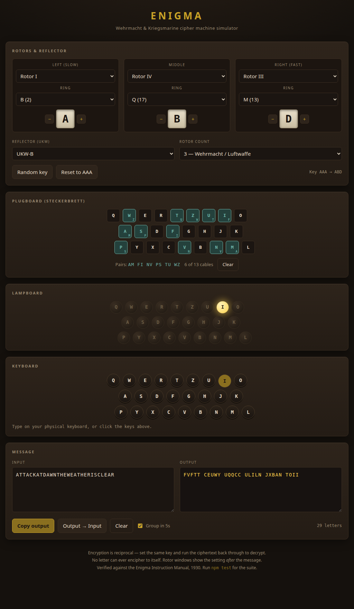

# Enigma

A historically accurate Enigma machine simulator with a web UI. No dependencies,
no build step — plain ES modules.



## Run

```
npm start      # http://localhost:8080
npm test       # 12 tests, including a real 1930 Enigma message
```

If 8080 is taken the server walks forward to the next free port and prints the
URL it settled on. Set `PORT` to choose a different starting point. Or just open
`index.html` through any static file server.

## What's modelled

| Part | Detail |
|---|---|
| Rotors | I–VIII with historical wirings and notches (VI–VIII have two notches) |
| Reflectors | UKW-A, UKW-B, UKW-C |
| Rotor count | 3 (Wehrmacht/Luftwaffe) or 4 (Kriegsmarine M4) |
| Ring setting | Ringstellung, per rotor |
| Ground setting | Grundstellung, per rotor, with +/- steppers |
| Plugboard | Steckerbrett, up to 13 cables, click two letters to wire them |
| Stepping | Includes the double-step anomaly of the middle rotor |

Two properties the simulator inherits from the real machine: encryption is
**reciprocal** (the same key setting decrypts), and no letter ever enciphers to
itself — the flaw that made Bletchley Park's cribs work.

## Using it

1. Set the rotors, rings, ground setting and plugboard — this is the *key*.
2. Type in the input box, or press keys on your physical keyboard to drive the
   lampboard one letter at a time.
3. To decrypt: set the **same** key, click **Output → Input**, and clear the
   extra input — the plaintext comes back.

The rotor windows display the position *after* the whole message, as a real
operator would see. The status line shows `Key AAA → AAM`: ground setting on the
left, final position on the right.

**Random key** picks rotors, rings, ground setting, reflector and ten plugboard
cables — standard wartime procedure.

## Layout

```
src/enigma.js   engine: Rotor, Plugboard, Enigma — no DOM
app.js          UI wiring
index.html      markup
styles.css      styling
server.js       static dev server
test/           node:test suite
```

The engine is pure and DOM-free, so it can be imported on its own:

```js
import { Enigma } from './src/enigma.js';

const e = new Enigma({
  rotors: ['II', 'I', 'III'],   // left to right
  reflector: 'A',
  positions: 'ABL',             // Grundstellung
  rings: 'XMV',                 // Ringstellung
  plugboard: 'AM FI NV PS TU WZ',
});

e.encode('GCDSEAHUGWTQGRKVLFGXUCALXVYMIGMMNMFDXTGNVHVRMMEVOUYFZSLRHDRRXFJWCFHUHMUNZEFRDISIKBGPMYVXUZ');
// FEINDLIQEINFANTERIEKOLONNEBEOBAQTETX...
```
